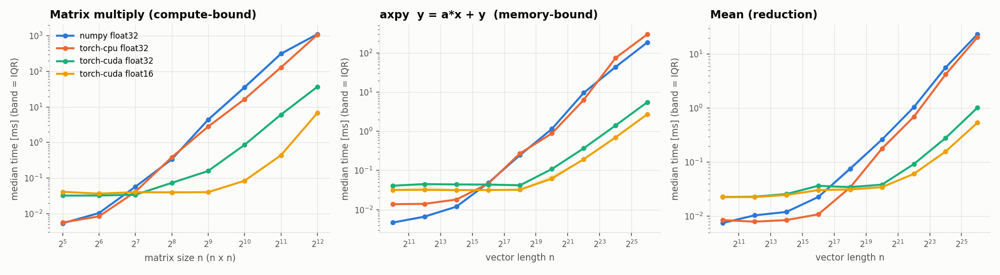
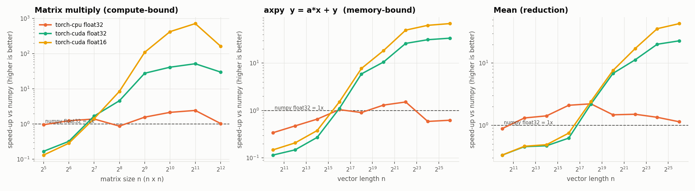
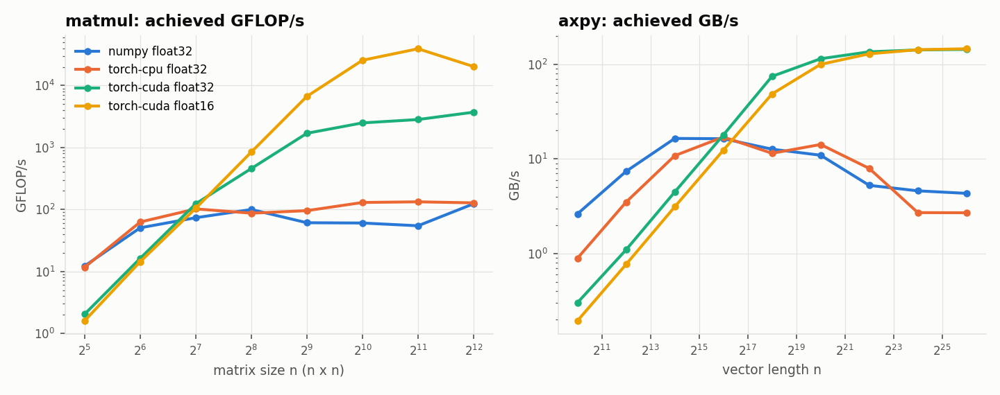
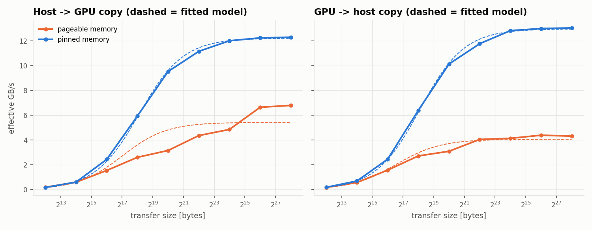
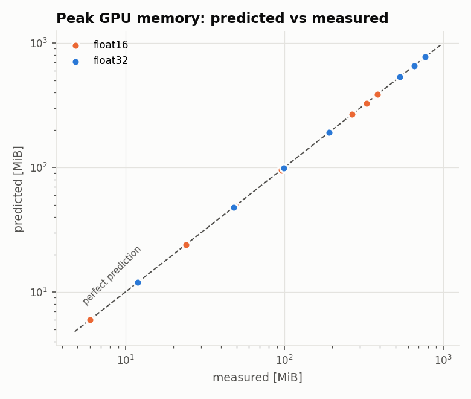

# Benchmark summary

- **GPU:** Tesla T4 (14.6 GiB, CUDA 13.0)
- **CPU:** x86_64  |  **Platform:** Linux-6.6.159+-x86_64-with-glibc2.39
- **Libraries:** numpy 2.1.3, torch 2.11.0+cu130
- **Run at:** 2026-10-28T16:35:39+00:00

## Time vs problem size

## Speed-up vs NumPy (float32)

### Where the GPU starts to win (float32)

| workload   |   gpu_wins_from_size |   max_speedup |   at_size |
|:-----------|---------------------:|--------------:|----------:|
| axpy       |                65536 |          33.5 |  67108864 |
| matmul     |                  128 |          51.9 |      2048 |
| mean       |               262144 |          22.9 |  67108864 |

## Achieved throughput

| workload   | backend    | dtype   |   peak_gflops |   peak_gb_per_s |
|:-----------|:-----------|:--------|--------------:|----------------:|
| axpy       | numpy      | float32 |      2.75     |           16.5  |
| axpy       | torch-cpu  | float32 |      2.85     |           17.1  |
| axpy       | torch-cuda | float16 |     49        |          147    |
| axpy       | torch-cuda | float32 |     24.1      |          145    |
| matmul     | numpy      | float32 |    123        |            4.74 |
| matmul     | torch-cpu  | float32 |    133        |            5.87 |
| matmul     | torch-cuda | float16 |      3.92e+04 |           74.9  |
| matmul     | torch-cuda | float32 |      3.71e+03 |           19.9  |
| mean       | numpy      | float32 |      4.02     |           16.1  |
| mean       | torch-cpu  | float32 |      7.7      |           30.8  |
| mean       | torch-cuda | float16 |    124        |          249    |
| mean       | torch-cuda | float32 |     65.6      |          263    |

## Host <-> device transfers

Model: `time = latency + bytes / bandwidth`, fitted by weighted least squares.

| direction   | memory   |   latency_us |   bandwidth_gb_per_s |   r_squared |
|:------------|:---------|-------------:|---------------------:|------------:|
| D2H         | pageable |         23.6 |                 4.06 |       0.995 |
| D2H         | pinned   |         21.8 |                13    |       1     |
| H2D         | pageable |         24.3 |                 5.43 |       0.922 |
| H2D         | pinned   |         23.2 |                12.2  |       1     |

## Peak memory: prediction vs measurement

| kind   | case                          | dtype   |   predicted_mib |   measured_mib |   error_pct |
|:-------|:------------------------------|:--------|----------------:|---------------:|------------:|
| matmul | n=1024                        | float32 |            12   |           12   |        0    |
| matmul | n=2048                        | float32 |            48   |           48   |        0    |
| matmul | n=4096                        | float32 |           192   |          192   |        0    |
| matmul | n=8192                        | float32 |           768   |          768   |        0    |
| mlp    | MLP 1024-4096-4096-1024 b=64  | float32 |            98.3 |           99.3 |       -1.01 |
| mlp    | MLP 4096-8192-8192-4096 b=256 | float32 |           532   |          532   |        0    |
| mlp    | MLP 4096-16384-4096 b=1024    | float32 |           656   |          656   |        0    |
| matmul | n=1024                        | float16 |             6   |            6   |        0    |
| matmul | n=2048                        | float16 |            24   |           24   |        0    |
| matmul | n=4096                        | float16 |            96   |           96   |        0    |
| matmul | n=8192                        | float16 |           384   |          384   |        0    |
| mlp    | MLP 1024-4096-4096-1024 b=64  | float16 |            49.1 |           49.1 |        0    |
| mlp    | MLP 4096-8192-8192-4096 b=256 | float16 |           266   |          266   |        0    |
| mlp    | MLP 4096-16384-4096 b=1024    | float16 |           328   |          328   |        0    |

## Verification

| status   |   cases |
|:---------|--------:|
| ok       |     104 |

Every timed result passed correctness, fresh-input and plausibility checks.
